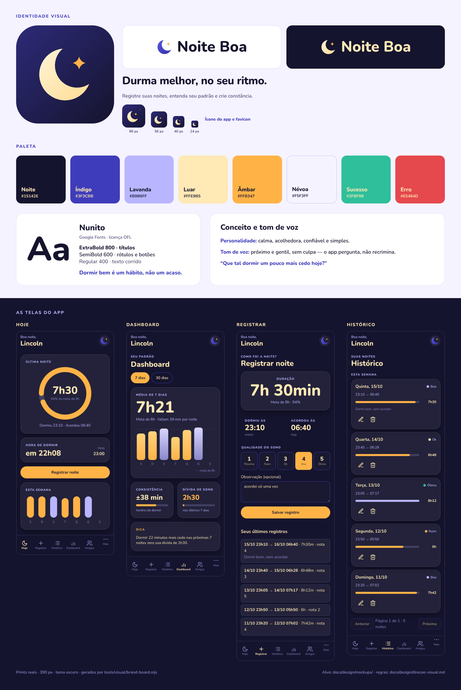

# Identidade visual: Noite Boa

> **Visual v2 (M9):** as telas do app seguem [`docs/design/direcao-visual.md`](design/direcao-visual.md).
> Este documento é a base da **marca** — nome, logo, paleta, tipografia e contraste — e vale
> por baixo daquilo: superfícies, tema claro, componentes, telas e largura estão descritos na
> direção visual e apontados aqui só como resumo.

## Conceito
**Noite Boa** descreve exatamente o resultado que o app busca entregar. O nome combina com a lua em formato de berço que abraça uma estrela: o sono como algo que se cuida. O visual é noturno, macio e calmo, sem parecer infantil.

- **Personalidade:** calma, acolhedora, confiável, simples.
- **Tom de voz:** próximo e gentil, sem culpa ("Que tal dormir um pouco mais cedo hoje?" em vez de "Você dormiu mal").
- **Slogan:** *Durma melhor, no seu ritmo.*
- **Nome definitivo:** "Noite Boa" — decisão registrada em [`nome-do-produto.md`](nome-do-produto.md), com as conferências de domínio/lojas/INPI e as pendências (logo do cabeçalho, repositório e Vercel). Um complemento ajuda a se destacar nas buscas (ex.: "Noite Boa — Diário do Sono").

## Logo
| Arquivo | Uso |
|---|---|
| `docs/assets/brand/icon.svg` / `icon-512.png` | Ícone do app (PWA, loja, redes sociais) |
| `docs/assets/brand/icon-maskable.svg` / `icon-maskable-512.png` | Ícone PWA "maskable" (sem cantos arredondados; o sistema recorta) |
| `docs/assets/brand/favicon.svg` / `favicon-32.png` | Aba do navegador |
| `docs/assets/brand/logo-horizontal-light.svg` | Logo com texto para **fundo claro** |
| `docs/assets/brand/logo-horizontal-dark.svg` | Logo com texto para **fundo escuro** |
| `docs/assets/brand/mark-light.svg` / `mark-dark.svg` | Só a lua com a estrela, sem fundo |

**Regras de uso**
- Área livre ao redor do logo: no mínimo a altura da letra "N".
- Tamanho mínimo: ícone 24 px; logo horizontal 160 px de largura (o wordmark "Noite Boa" é mais largo que a marca sozinha — abaixo disso a letra fica ilegível).
- Não esticar, girar, trocar as cores nem aplicar sombras no logo.
- Fundo claro usa a versão `light`; fundo escuro usa `dark`. Não colocar o logo sobre fotos sem uma camada escura por trás.

## Paleta
| Nome | Hex | Uso |
|---|---|---|
| Noite | `#15142E` | Fundo escuro, texto em fundo claro |
| Índigo | `#3F3CBB` | Cor primária (links, elementos interativos) |
| Lavanda | `#B9B6FF` | Detalhes, texto secundário em fundo escuro, barras de gráfico |
| Luar | `#FFE9B5` | Destaques em fundo escuro (números grandes, títulos) |
| Âmbar | `#FFB347` | **Ação principal** (botão), estrela do logo, valores abaixo da meta |
| Névoa | `#F5F3FF` | Fundo claro das telas |
| Sucesso | `#2FBF9B` | Confirmações |
| Erro | `#E5484D` | Erros |

**Contraste (WCAG)**, calculado a partir dos valores acima:

| Combinação | Razão | Pode usar para texto? |
|---|---|---|
| Noite sobre Névoa | 16,35:1 | Sim |
| Índigo sobre Névoa | 7,43:1 | Sim |
| Índigo sobre Branco | 8,15:1 | Sim |
| Luar sobre Noite | 15,00:1 | Sim |
| Lavanda sobre Noite | 9,56:1 | Sim |
| Âmbar sobre Noite | 10,07:1 | Sim |
| Noite sobre Âmbar (texto do botão) | 10,07:1 | Sim |
| Erro sobre Névoa | 3,57:1 | Só texto grande ou com ícone |
| Sucesso sobre Névoa | 2,12:1 | **Não**; usar só com ícone ou fundo |
| Âmbar sobre Névoa | 1,62:1 | **Não**; nunca texto ou ícone fino em fundo claro |
| `--color-erro-texto` `#C1272D` sobre Névoa / branco | 5,33:1 / 5,84:1 | Sim — **usar este para texto de erro** |
| `--color-sucesso-texto` `#16745A` sobre Névoa / branco | 5,71:1 / 5,20:1 | Sim — **usar este para texto de sucesso** |

Regra prática: no fundo claro o texto é Noite ou Índigo. Âmbar em fundo claro só como preenchimento de botão (com texto Noite). Mensagens de erro/sucesso em texto usam as variantes `*-texto` acima (adicionadas na issue #35; `#E5484D` e `#2FBF9B` continuam para bordas, ícones e preenchimentos) — medições em [`docs/qualidade.md`](qualidade.md).

**Derivados do visual v2** (não são cores novas da marca): gradiente de fundo `#3A3796` → `#1E1C52`, aba inativa `#8B88C9`, Âmbar escuro `#B8690A` (a versão do Âmbar com contraste em fundo claro) e as variantes de gradiente das barras (`#D9D6FF` → `#8B88C9` e `#FFD27A` → `#FFB347`). Valores e contraste em [`design/direcao-visual.md`](design/direcao-visual.md) §2, §3 e §8.

## Tipografia
**Nunito** (Google Fonts, licença SIL OFL, gratuita, inclusive para uso comercial). A licença está em `docs/assets/brand/Nunito-OFL.txt`.

| Uso | Peso | Tamanho sugerido |
|---|---|---|
| Títulos | 800 | 32 a 44 px |
| Subtítulos e rótulos | 700 / 600 | 16 a 24 px |
| Texto corrido | 400 | 16 px (mínimo 14 px) |
| Números de destaque (ex.: 7h 42min) | 800 | 56 a 64 px em tela cheia, 30 px em cartão (v2), cor Luar em fundo escuro |

Para usar no front-end, importe `docs/assets/brand/tokens.css` (ele já carrega a fonte e define as variáveis de cor, tipografia, espaçamento e raios).

## Superfícies (v2)
Duas superfícies, uma linguagem só — cartão arredondado para tudo:

| Tema | Fundo | Cartão |
|---|---|---|
| Escuro (o rosto da marca) | gradiente `#3A3796 → #1E1C52 → #15142E` | `rgba(255,255,255,.06)`, borda `rgba(185,182,255,.22)`, raio 24 px, padding 18 px |
| Claro | Névoa `#F5F3FF` | branco, borda `rgba(63,60,187,.18)`, sombra `0 8px 24px rgba(21,20,46,.08)` |

Valores exatos, botão, barra inferior e régua de largura: [`design/direcao-visual.md`](design/direcao-visual.md) §2 e §9.

## Tema claro (v2)
O tema inicial é **`auto`** (segue o `prefers-color-scheme` do sistema) e o usuário escolhe
claro/escuro/auto nas Configurações — não existe mais um "padrão ao anoitecer" fixo.

O claro precisa ter **paridade** com o escuro: texto Noite, destaques em Índigo `#3F3CBB`
(8,15:1 sobre branco) e botão principal continua Âmbar com texto Noite. "Abaixo da meta" usa
**Âmbar escuro `#B8690A`** em barras e ícones (4,15:1 sobre branco, **nunca em texto**) e
"dentro da meta" usa Índigo: o Âmbar claro `#FFB347` não tem contraste sobre fundo claro.
Detalhe: [`design/direcao-visual.md`](design/direcao-visual.md) §3.

## Componentes (diretrizes rápidas)
- **Botão principal:** pílula de 54 px, fundo Âmbar, texto Noite, peso 800, 17 px.
- **Cartões:** superfície translúcida no escuro / branco com borda Índigo no claro, raio 24 px (ver "Superfícies").
- **Gráficos:** gradiente Lavanda (`#D9D6FF → #8B88C9`) nas barras ≥ meta, gradiente Âmbar (`#FFD27A → #FFB347`) nas < meta, raio 10 px.
- **Barra inferior (celular):** 78 px, ícone ativo em Luar, inativo em `#8B88C9`.
- **Acessibilidade:** nunca só cor (sempre texto ou ícone junto), alvos de toque de pelo menos 44 px, foco visível com anel Âmbar de 2 px.

A lista completa de componentes e os estados obrigatórios (hover, foco, pressionado, desabilitado,
carregando) estão em [`design/direcao-visual.md`](design/direcao-visual.md) §4; as telas, em §5.

## Como foi gerado
- **Logo:** as formas nasceram de um script (geometria + traçado da Nunito ExtraBold em curvas, sem depender da fonte instalada). O wordmark atual veio de `frontend/public/logo-horizontal-dark.svg` (o mesmo que o app usa) e a variante `light` foi derivada dele trocando a lua para indigo e o texto para Noite; os PNG são rasterização dos SVG a 3× (rsvg). Para trocar o nome, regere as duas variantes e os dois PNG.
- **Quadro da marca (`brand-board.png`):** [`tools/visual/brand-board.mjs`](../tools/visual/brand-board.mjs) — monta a identidade (marca, paleta, tipografia) e as **telas reais** do app (Hoje, Dashboard, Registrar e Histórico, prints de 390 px no tema escuro). O comando está no [README](../README.md#prints-mockups-e-o-quadro-da-marca).

## Próximos passos
- [ ] Validar a disponibilidade do nome (domínio, GitHub, lojas, INPI)
- [ ] Testar o ícone em fundo claro e escuro no celular de verdade
- [ ] Referenciar `icon-192.png` e `icon-512.png` no `manifest.json` do PWA (issue do pós-MVP)
